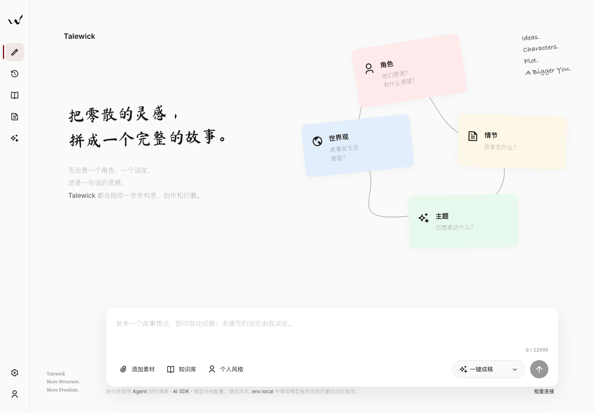

# Talewick

**从一个故事想法，到可以继续打磨的小说。**

中文 | [English](README.en.md)

Talewick 是一个在本机运行的 AI 小说创作工作台，主要面向中文短篇创作。你可以和助手讨论故事、生成分章初稿、阅读与编辑正文，再针对整篇或选中段落提出修改，决定哪些建议进入最终稿件。

项目将创作界面、资料管理、写作流程和验证工具分开维护，保留清晰的模块接口，方便作者使用、开发者扩展和研究者检查流程。

> 当前为持续开发中的预览项目。推荐从源码启动；本地历史发布包、实验报告和静态演示不代表当前源码的发布验收。界面和主要说明以中文为主，英文 README 不表示产品已完成英文适配。



## 最近更新 · 2026-10-14

- **整稿修订**：从完整原稿出发，依次进行全文诊断、修改方案、受影响场景修改和独立复读。查看候选、差异与风险后，由你决定整体采纳或保留原稿。
- **跨章连续性检查**：记录日期、物件去向和交接事件的证据与反证。检查未完成时，稿件仍可保存、编辑和导出，同时显示未完成状态；不把缺少证据自动判为矛盾。
- **资料采用更明确**：规划后补查的材料逐项采用或拒用；叙事观察须绑定实际供应的原文窗口，并通过范围、版本和预算校验。公开版提供处理代码，资料库和分析数据仍由用户自行准备。
- **篇幅与恢复**：按已写正文调整剩余章节预算，显示篇幅或章数要求是否满足；恢复沿用已保存阶段，整稿修订期间的手工编辑不会被旧候选覆盖。

这些功能用于形成可审阅的候选和诊断，不承诺文学质量提升。独立 C01–C06 辅助检查仍保留，完整 Full15 尚未接通；独立事实小单元目前是开发接口，未成为产品的自动采纳门槛。此前六篇[阅读示例](examples/README.md)继续保留，本轮没有加入内部样本。公开版本的实际验证范围见 [验证记录](VERIFICATION.md)。

## 可以做什么

- **讨论与写作**：通过对话表达题材、人物、冲突、篇幅与结局要求，进入需求整理、故事规划和逐章写作。
- **审阅与修订**：生成独立审稿意见，支持整稿、定向和选段修订；候选与差异单独呈现，由你采纳。
- **保护已有稿件**：支持编辑、版本对比和恢复；生成期间手动修改了正文时，模型结果另行保留。
- **保存与恢复任务**：保存阶段产物、任务状态和完成的章节，支持取消、中断后恢复与刷新后找回进度。
- **使用创作资料**：导入 TXT/Markdown、管理知识与风格资料；数据模块提供资料分析、检索和相关性筛选能力，实际可用内容取决于本机资料库。
- **导出作品**：在工作台中导出 TXT 或 Markdown。

## 快速开始

### 1. 准备环境

- Node.js **22.13 或更新版本**，以及 npm。
- Python **3.10 或更新版本**；确认终端执行 `python3 --version` 能显示版本。全文辅助检查只使用 Python 标准库。
- 下载本仓库 ZIP 并解压，或使用 Git 克隆仓库。
- 准备模型服务的 API 地址、模型名称与 API Key。默认 Agent 流程需要模型支持工具调用。

使用 Git 时，可先执行：

```sh
git clone https://github.com/liaowu-boos/talewick-community.git
cd talewick-community
```

请保留整个仓库的目录关系，产品服务会引用同级的数据、创作和验证模块。以下命令从仓库根目录开始执行：

```sh
cd modules/product/talewick-gui
npm ci
cp .env.example .env.local
```

Windows PowerShell 可用 `Copy-Item .env.example .env.local` 复制配置文件。

### 2. 配置模型

编辑刚复制的 `.env.local`，填写：

```dotenv
TALEWICK_API_BASE_URL=https://api.deepseek.com
TALEWICK_MODEL=your-model-id
TALEWICK_API_KEY=your-api-key
TALEWICK_PORT=4326
TALEWICK_ENGINE=ai-sdk
```

将 `your-model-id` 替换为你所使用服务实际提供的模型名称，将 `your-api-key` 替换为自己的密钥。示例文件里的模型名称也需要核对，不是可用性保证。其余超时配置可先保留示例值。

代码提供 DeepSeek 和 OpenAI-compatible 适配。使用其他服务时，修改基础地址和模型名称；具体模型对工具调用、结构化输出和输出长度的支持需要实际验证。

如需使用固定创作流程，可设置 `TALEWICK_ENGINE=fixed`。它只改变新创作任务的执行引擎，已有任务继续使用原引擎恢复；不表示对话入口及所有功能都不再需要工具调用。修改配置后重启服务。

### 3. 构建并启动

仍在 `modules/product/talewick-gui` 目录执行：

```sh
npm run build
npm start
```

打开 [http://127.0.0.1:4326](http://127.0.0.1:4326)。例如发送：

> 请写一篇约 3000 字的中文短篇：一位即将退休的邮递员收到一封寄给三十年前自己的信。以悬疑开场，重点写父女关系，结尾克制，不要用梦境解释。

完成后可以直接编辑，或选中一段并提出具体修改要求。需要通读全稿调整时，点击稿件页的「整稿修订」，填写目标，启动后查看方案、候选和复读风险，再决定采纳或保留原稿。只打开修订弹窗不会调用模型。

公开版不附带内部小说样本、拆解数据或旧发布包。六篇完整作品见 [阅读示例](examples/README.md)，其中最新两篇交付于 2026-10-09；它们不自动进入资料库。

## 数据和模型调用

界面与服务在本机运行，模型生成会向你配置的模型服务发送本次任务需要的需求、稿件和资料，可能产生该服务的 API 费用。一次创作包含多次模型调用。新稿保存后的辅助检查通常另外请求两次；手动重查也可能产生费用。可在全文辅助检查面板取消检查。整稿修订的诊断、规划、场景修改和复读也会分别调用模型，次数随方案与失败恢复情况变化。

- API Key 由服务端读取，保存在本机 `.env.local`，不应提交到仓库。
- 任务和生成产物默认保存在产品目录的 `.local-runs/`，可通过 `TALEWICK_RUNS_DIR` 修改。
- 浏览器也保存项目和编辑状态。清除浏览器数据不会删除磁盘上的任务文件，但目前没有完整的项目一键重建界面。
- 重要作品请及时导出，并备份浏览器数据及任务目录。提交 Issue 或 PR 时，请移除密钥、私人稿件和个人路径。

## 当前边界

| 项目 | 当前情况 |
| --- | --- |
| 使用方式 | 本机网页工作台；源码服务默认监听 `127.0.0.1` |
| 创作引擎 | 默认 AI SDK ToolLoopAgent；保留固定流程 |
| 质量检查 | 模型审稿、全文状态与跨章事件链检查、独立 C01–C06 辅助检查；历史完整 Full15 平台未启用，公开规则版本的真实提供商验证仍有限 |
| 辅助检查范围 | C05 仅在明确要求四五章切口时适用；产品未连接参考语料，C06 显示未评估 |
| 资料库 | 需要本机导入或配置；开发记录中的样本数量不代表新安装自带相同资料 |
| 交互模式 | 一键成稿、定向修订和整稿修订已接入；轻度参与、专业审稿的完整逐阶段交互尚未完成 |
| 其他能力 | 风格训练、完整产品账号系统、原生桌面安装程序尚未完成 |
| 作品交付 | 工作台提供 TXT/Markdown；当前公开版未提供 PDF/ZIP 导出 |

任务成功或工程测试通过，不等于作品已经达到发表标准，也不证明某种写作方法一定改善文学质量。最终稿件仍需要作者判断和编辑。

## 项目结构

```text
modules/
  product/talewick-gui/             # React 界面与 Node.js 本机服务
  creation/runtime/                # 需求、规划、正文、审稿与修订
  creation/novel-review/            # Python 辅助检查、公开规则与合成测试
  creation/write-short-fiction-candidate/references/  # 创作流程规则
  data/                            # 资料、来源、分析与知识供应
  validation/                      # 基础检查和实验验证工具

examples/                          # 六篇作品，含最新两篇修订稿，仅供阅读展示
licenses/                          # 第三方许可声明
```

当前开发入口是 `modules/product/talewick-gui/`，模块分工见 [模块说明](modules/README.md)。数据处理代码随项目公开，内部数据集不公开；新安装的资料库为空。

## 参与开发

欢迎通过 Issue 提交问题和建议，通过 Pull Request 改进项目。适合参与的方向包括安装体验、模型适配、任务恢复、资料检索、编辑交互、测试和文档翻译。

### 本地开发

先完成模型配置和 `npm ci`，然后在产品目录打开两个终端：

```sh
# 终端一：后端
npm start
```

```sh
# 终端二：前端开发服务器
npm run dev -- --port 4323
```

打开 [http://127.0.0.1:4323](http://127.0.0.1:4323)。Vite 默认把 `/api` 转发到 `4326`；如果修改了后端端口，也需要调整 `vite.config.ts` 中的代理。

提交前先在仓库根目录运行 `node tools/check-public.mjs`，再进入产品目录运行相关检查：

```sh
npm run test:runtime
npm run test:ui
npm run test:review
npm run build
```

`test:runtime` 覆盖包脚本指定的服务端、创作与资料采用流程、叙事观察、连续性与整稿修订协议、辅助检查任务和界面状态测试；`test:review` 运行 Python 检查协议测试。两者并非整个仓库的全部实验。测试通过也不能替代真实模型兼容性与作品质量验证。

### 提交建议

1. Bug 报告请包含复现步骤、预期与实际结果、系统和 Node.js 版本，以及脱敏的模型配置与错误信息。
2. 较大的功能或架构调整，先用 Issue 说明问题和方案，便于讨论范围。
3. PR 聚焦一个问题，说明改动、验证方式和已知限制；界面变更附截图。
4. 修改界面前阅读 [产品开发约定](modules/product/talewick-gui/AGENTS.md)。改动应保留稿件保护、用户采纳和任务恢复行为。
5. 请勿提交 `.env.local`、私人运行目录、未获授权的文本或与改动无关的生成文件。

## 进一步阅读

- [产品运行入口](modules/product/talewick-gui/README.md)
- [模块说明](modules/README.md)
- [全文辅助检查](modules/creation/novel-review/README.md)
- [文件式资料库](modules/data/runtime/FILE-LIBRARY.md)
- [阅读示例](examples/README.md)
- [第三方声明](THIRD_PARTY_NOTICES.md)

## 许可证与第三方材料

本项目的原创代码采用 [GNU Affero General Public License v3.0（AGPL-3.0-only）](LICENSE)。允许使用、修改和商业使用；分发受许可覆盖的作品时，须遵守相应的源码提供和许可证保留要求。如果修改本程序并通过网络供用户交互使用，须按许可证要求向这些用户提供该修改版本的对应源码。完整权利与义务以 [LICENSE](LICENSE) 为准。

第三方代码、字体、图片和文本材料仍遵循各自的许可或授权说明，不因本项目采用 AGPL-3.0 而被重新授权。贡献者保留其贡献的版权，原创贡献按 AGPL-3.0-only 提供；如未来需要额外商业授权，将另行协商。参与方式见 [贡献指南](CONTRIBUTING.md)。
